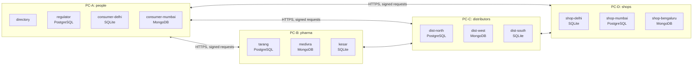
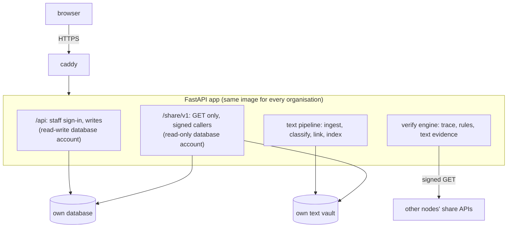
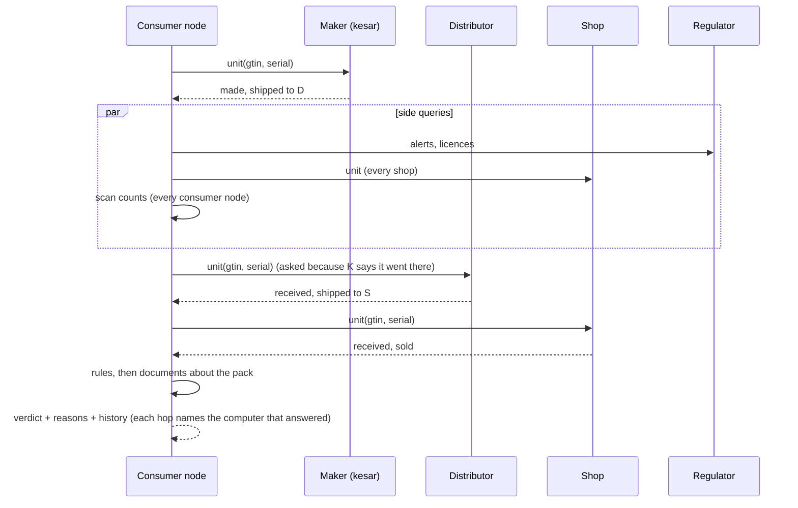
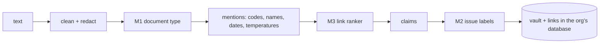

# Architecture

Asali Network checks whether a medicine pack is genuine by asking the organisations that handled it. No organisation hands its data to a
central store. Each one keeps its own database, in its own structure, and lets the others read a small, controlled part of it.

## The four computers



Twelve organisations, three storage engines, one directory. The directory holds only addresses, public keys and issuer codes. It holds no
medicine data. Nodes cache it on disk and keep working if it goes down.

## Inside one node



Read-only sharing is enforced three ways, and each has a test that tries to break it (`services/node/tests/stores/test_readonly.py`,
`tests/api/test_share_api.py`):

1. **HTTP:** the share router registers GET routes only; `POST`, `PUT`, `PATCH` and `DELETE` return 405.
2. **Database account:** the share API uses a separate connection: a PostgreSQL role with `SELECT` only, a MongoDB user with the `read` role,
   SQLite opened with `mode=ro`, the text vault opened with `mode=ro`. A write fails inside the database.
3. **Scope:** a caller sees what it needs. There is no "list all sales". A shipment list shows only shipments addressed to the caller.
   Bulk complaint lists are for the regulator only.

## How a verification works



The chain is a dependent ("bind") join: each hop's question needs the previous hop's answer. The side queries do not, so they run beside
the chain. Every call has a 2 s timeout, one retry, a breaker that skips an organisation after two failures, and a 6 s budget for the
whole check. An organisation that did not answer is named in the result.

Rules (`services/node/asali_node/verify/rules.py`) are table-driven and have no network or clock inside them. The verdict is the strongest
reason: any do-not-use reason wins; otherwise a missing source gives "cannot check"; otherwise any caution gives "caution"; otherwise genuine.
No score exists anywhere.

## The text pipeline



Text can change a verdict only under fixed rules (`PLAN.md` 12.4): an official notice linked with confidence 0.9 or more can raise
a do-not-use reason; a lower link only a caution; a temperature report only a caution; a single complaint nothing at all.

## Where each course idea lives

| Idea | Where |
|---|---|
| Sources | 12 organisation databases and their text vaults (`services/node/asali_node/stores/`, `vault/`) |
| Wrappers | One store per organisation: `stores/<org>.py` over its own schema in `schemas/<org-id>/` |
| Global-as-view mapping | `schemas/<org-id>/MAPPING.md`: one row per canonical field |
| Canonical model | `services/node/asali_node/canonical.py` |
| Mediator and query plan | `verify/trace.py` (bind join along the custody chain), `verify/engine.py` |
| Entity resolution | Code correction (`packages/asali_codes`) and text-to-record linking (`packages/asali_text/link.py`) |
| Provenance | Every fact in a result carries the organisation and the computer that said it (`served_by`) |
| Heterogeneity | Different structures, date formats, status codes and party codes, mapped in each store |
| Unstructured data and ML | `packages/asali_text`: models M1 to M5, evaluated in `docs/evidence/ml/report.md` |

## Honest limits

- The text vault is SQLite full-text search, not Meilisearch. Meilisearch could not run on the development PC.
- Nothing has run on four computers yet. The simulation runs all organisations as processes on one computer.
- Docker and the generated compose files have not been run on this PC (no WSL2).
- The issue-label model misses its target on unseen phrasings; the hand-written test set has not been provided.

## Phase 2 and Phase 3 inside the network

The three phases are one system. Phase 1 gave each source its own schema and an integration layer; Phase 2 added matching and cleaning under noise; Phase 3 added tables joined by keys, context found through them, and text searched with that context. In this network:

**Noise (Phase 2).** A code that was misread is cleaned in three steps, each with a reason: the weighted edit search finds issued codes a look-alike slip away (`asali_codes/candidates.py`); the check character keeps the candidate set small and exact; and what else is printed with the code (lot, expiry) separates candidates the characters cannot (`read.py`, `_by_label`). A consumer always confirms; staff are corrected against the expected set. `POST /api/similar` lists every issued code near a reading and every reading recorded for an issued code. `GET /api/quality` audits an organisation's own recorded codes and proposes fixes; `POST /api/quality/apply` makes one and leaves a trail. `docs/evidence/matching/` and `docs/evidence/quality/` have the numbers.

**Context (Phase 3).** Every database holds at least four related tables joined by keys. For a pack, each node on its route (and the regulator and the consumer portals) finds the rows that mention it in its own database, then follows its own foreign keys (PostgreSQL and SQLite read them from the database; MongoDB stores declare references) joining the neighbouring table that adds the most relevant terms, and returns the strongest terms with the table, column and join path (`context/score.py`, `/share/v1/context`). The asking node merges the terms, boosting those found by several organisations and those that match the question (`context/aggregate.py`, `verify/context.py`).

**Text with the context.** The merged terms search every relevant text vault; a document that matches at least two of them and was not already linked by the text models is shown as related reading. Linked documents can still become reasons; related documents never do.

```
asking node                     each node on the route                 each node's text vault
  trace the chain  ------------>  unit view (share API)
  ask for context  ------------>  rows about the pack, then own foreign keys -> terms
  merge terms      <------------  terms with table, column, join path
  search text with the terms  ---------------------------------------->  documents sharing the terms
```
